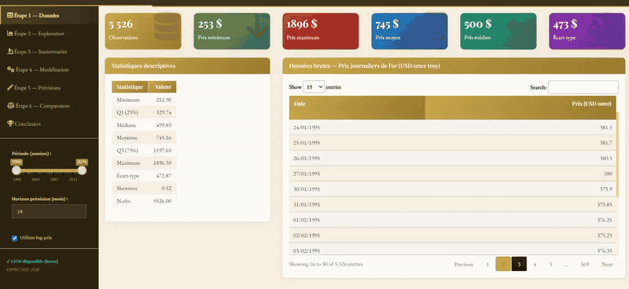
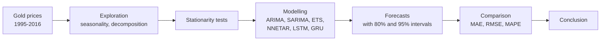

# Gold Price Forecasting

**Six forecasting models compared on gold prices (1995–2016), explored in an interactive R Shiny dashboard.**

*Time series project, 2026.*

> The source code for this project is private. The full demo video is on my portfolio: **[roua-slama-portfolio.netlify.app](https://roua-slama-portfolio.netlify.app/#forecasting)**. The dashboard interface is in French.

## The question

Which model forecasts the gold price best, and can we trust it? The dashboard walks through the whole time series workflow, from the raw data to a model comparison, so each step can be inspected instead of taken on faith.

## What it does

- **Explore the series.** Descriptive statistics, monthly seasonality and trend decomposition.
- **Check stationarity** before modelling.
- **Six models:** ARIMA, SARIMA, ETS, NNETAR, LSTM and GRU, each with its own fit and residual diagnostics (residuals over time, distribution, autocorrelation, Ljung-Box).
- **Forecasts with uncertainty.** Adjustable history and forecast horizon, with 80% and 95% prediction intervals.
- **Model comparison.** MAE, RMSE and MAPE on a held-out 18-month test period, plus AIC for the parametric models.

## Workflow

## Stack

R · Shiny · ARIMA · SARIMA · ETS · NNETAR · LSTM · GRU

## Contact

Roua Slama, Computer Science Engineering student at ESPRIT (BI & ERP), looking for a PFE in 2027.
[LinkedIn](https://linkedin.com/in/roua-slama) · [Portfolio](https://roua-slama-portfolio.netlify.app/) · slamaroua10@gmail.com
